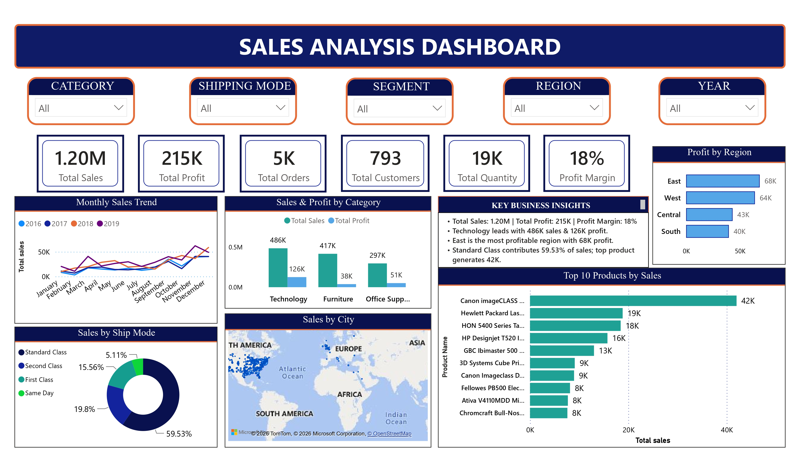
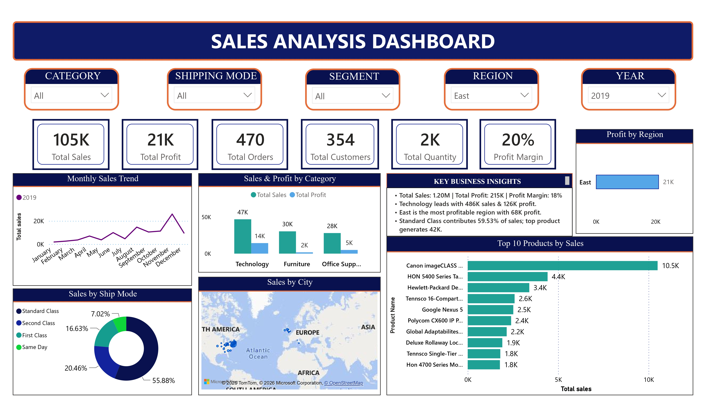
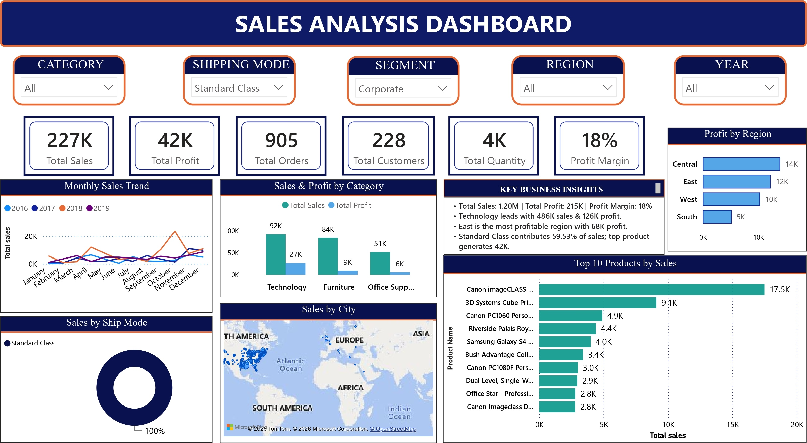

# 📊 Sales Analysis Dashboard – Power BI

## 📌 Project Overview
An interactive Sales Analysis Dashboard developed using Microsoft Power BI to analyze business performance, sales trends, profitability, customer segments and regional performance.

The objective of this project is to transform raw sales data into meaningful business insights through interactive visualizations and reporting.

## 🛠️ Tools & Technologies
- Microsoft Power BI
- Power Query
- DAX
- Data Cleaning
- Data Visualization
- Business Intelligence

## 📈 Dashboard Features
- Sales, Profit, Orders and Customer KPIs
- Monthly Sales Trend Analysis (2016–2019)
- Category-wise Sales and Profit Analysis
- Region-wise Profit Analysis
- Shipping Mode Analysis
- Customer Segment Analysis
- Sales by City Map Visualization
- Top Product Sales Analysis
- Interactive Slicers for Category, Shipping Mode, Segment, Region and Year

## 💡 Key Business Insights
- **Total Sales:** 1.20M
- **Total Profit:** 215K
- **Total Orders:** 5K
- **Total Customers:** 793
- **Total Quantity Sold:** 19K
- **Profit Margin:** 18%

### Additional Insights
- Technology generated the highest sales of 486K.
- Technology contributed the highest category profit of 126K.
- East region recorded the highest regional profit of 68K.
- Standard Class accounted for 59.53% of shipping orders.

## 🖼️ Dashboard Screenshots

### Main Dashboard

### Regional and Year Analysis

### Shipping Mode and Customer Segment Analysis

## 📁 Project Files
- `sales_Analysis.pbix` – Power BI dashboard file.
- Dashboard screenshots – Visual representation of project results.

## 👩‍💻 Author
**Ishita Patil**

BCA Final-Year Student | Aspiring Data Analyst

GitHub: [ishitapatil91](https://github.com/ishitapatil91)
